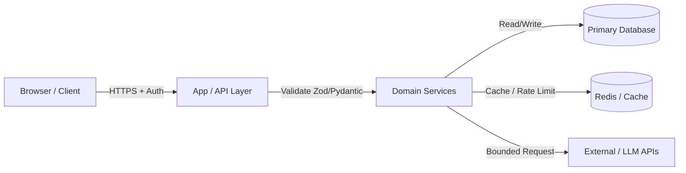
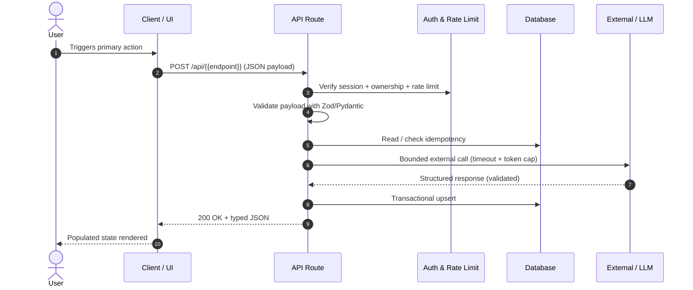

<!--
  ╔══════════════════════════════════════════════════════════════╗
  ║  TANISH'S SETUP TOOLKIT · template · tanisheesh.in            ║
  ║  Keep the author footer at the bottom of the generated file.  ║
  ╚══════════════════════════════════════════════════════════════╝
-->

# {{PROJECT_NAME}} — Architecture

<!--
Companion to PRD.md.
Audience: a senior engineer who needs to build, debug, scale, or audit
the system from internals alone. Replace every {{PLACEHOLDER}} with real
facts, exact versions, and code-verified limits. Delete unused sections.
-->

---

## 1. Stack & Runtime Versions

| Layer | Technology & Exact Version | Runtime / Region / Notes |
|---|---|---|
| Framework | {{e.g. Next.js 16 (App Router) · TypeScript 5.x}} | {{e.g. Node 22.x · Vercel `bom1`}} |
| UI & Styling | {{e.g. React 19 · Tailwind CSS 4 · lucide-react}} | {{e.g. CSS var tokens, WCAG AA}} |
| Auth | {{e.g. Auth.js v5 / Clerk}} | {{e.g. JWT / DB sessions, HTTP-only cookies}} |
| Database & ORM | {{e.g. PostgreSQL 16 (Neon) · Prisma 6}} | {{e.g. Pooled connection string, max 10 conns}} |
| Cache / Queue | {{e.g. Upstash Redis / BullMQ}} | {{e.g. TTL 300s / 3 retries w/ exp backoff}} |
| AI / LLM | {{e.g. Anthropic Claude Sonnet / Groq Llama 3.3-70B}} | {{e.g. 30s timeout, 1,500 output token cap}} |
| Testing & Security | {{e.g. Vitest · Playwright · axe-core · CodeQL · Gitleaks}} | {{e.g. Enforced on every PR via GitHub Actions}} |

---

## 2. System Topology & Components



```text
src/
  {{app_or_routes}}/     {{thin route handlers & UI pages — input validation -> service call}}
  {{components_ui}}/     {{pure domain-agnostic UI primitives (zero fetch/business logic)}}
  {{components_feat}}/   {{feature UI composed from ui/ primitives}}
  {{lib_or_server}}/     {{business logic, Zod/Pydantic schemas, DB/API clients}}
  {{hooks_or_workers}}/  {{reusable hooks / background workers}}
```

### {{Component 1 — e.g. API / Route Boundary}}
{{What triggers it, what it validates, what it writes/calls, and what it explicitly does NOT do.}}

### {{Component 2 — e.g. Core Processing / Domain Engine}}
{{Exact responsibilities, invariants, and boundaries.}}

### {{Component 3 — e.g. Background Worker / Sync Pipeline}}
{{Concurrency, retry semantics, and failure isolation.}}

---

## 3. End-to-End Request Flow



1. **Trigger:** {{Step 1}}
2. **Validation & Auth:** {{Step 2}}
3. **Core Execution:** {{Step 3}}
4. **Persistence:** {{Step 4}}
5. **Response & UI State:** {{Step 5}}

---

## 4. Database Schema & Indexing

```mermaid
erDiagram
  {{USER}} ||--o{ {{RESOURCE}} : owns
  {{RESOURCE}} ||--o{ {{CHILD}} : has
```

| Model / Table | Key Columns & Types | Constraints / Relations | Purpose |
|---|---|---|---|
| `{{User}}` | `id (uuid PK)`, `email (text unique)` | Cascade or restrict policy | {{Stores account identity}} |
| `{{Resource}}` | `id (uuid PK)`, `userId (FK)`, `status (enum)`, `createdAt` | `FK userId -> User(id) ON DELETE CASCADE` | {{Core domain entity}} |
| `{{AuditOrChild}}` | `id (uuid PK)`, `resourceId (FK)`, `payload (jsonb)` | Unique composite `(resourceId, externalId)` | {{Idempotency / child rows}} |

**Hot-Path Indexes:**
- `{{table(col1, col2)}}` — {{serves `WHERE col1 = ? ORDER BY col2 DESC` dashboard query without seq scan}}.
- `{{table(unique_key)}}` — {{enforces idempotency on duplicate webhook/sync retries}}.

---

## 5. Caching, State & Concurrency Control

- **Caching strategy:** {{e.g. Redis cache with 300s TTL on read-heavy summaries, or Next.js `revalidateTag` invalidated on mutation; "none — direct DB reads" if uncached}}.
- **Idempotency & duplicate prevention:** {{e.g. Unique constraint on `(provider, deliveryId)` / upsert keyed on natural ID; UI submit disabled while pending}}.
- **Concurrency & transactions:** {{e.g. Prisma `$transaction` for multi-table balance/order updates; optimistic concurrency or atomic `UPDATE ... WHERE`}}.

---

## 6. AI / LLM Design

<!-- Include ONLY if the project calls an LLM. Delete this whole section otherwise. -->

### Models & Token Budgets
| Task | Provider & Model | Max Input | Max Output | Timeout | Est. Cost / Call |
|---|---|---|---|---|---|
| {{e.g. Primary inference}} | {{e.g. Claude / Groq}} | {{e.g. 4,000 tokens}} | {{e.g. 1,500 tokens}} | {{e.g. 30s}} | {{e.g. ~$0.002}} |

### Input & Pre-Processing
{{What deterministic filtering/chunking runs BEFORE the LLM? Never send raw unbounded blobs if pre-filtered.}}

### System Prompt & Injection Defense
{{How system instructions are separated from untrusted user/external data (XML/structural delimiters), strict output rules, and explicit prohibitions against inventing findings.}}

### Response Schema
```jsonc
{
  "{{field}}": "{{type}}",
  "{{items}}": [{ "{{key}}": "{{type}}" }]
}
```

### Validation & Graceful Degradation
- **Schema check:** {{e.g. Validated via Zod `.safeParse()`; max 1 repair/retry attempt.}}
- **Provider down / malformed output:** {{e.g. Degrades gracefully to deterministic stats/error banner — core app remains usable.}}

---

## 6b. ML / Geospatial / Hardware Pipeline

<!-- Include ONLY for ML, CV, geospatial, or embedded/digital-twin projects. Delete otherwise. -->

- **Models / Algorithms:** {{e.g. Pre-trained LightGBM / MediaPipe Pose / 1D Kalman Filter / classical DIP filters — exact hyperparameters & inference latency}}
- **Datasets & Provenance:** {{e.g. Sentinel-2 L2A bands, MODIS thermal, OpenStreetMap footprints — resolution, CRS, preprocessing pipeline}}
- **Hardware / Telemetry (if applicable):** {{e.g. MCU target (ESP32-S3), sensors, baud/LoRa frequency (865 MHz), packet framing, offline fallback}}

---

## 7. API Contracts

| Method | Route | Auth & Ownership | Rate Limit | Request / Query | Responses (`2xx` / `4xx` / `5xx`) |
|---|---|---|---|---|---|
| `GET` | `/api/health` | Public | None / 60/min | `—` | `200 { ok, db }` · `503` if DB unreachable |
| `GET` | `{{/api/items}}` | Session (`userId`) | {{e.g. 60/min}} | `?cursor=&limit=20` (max 50) | `200 { items, nextCursor }` · `401` |
| `POST` | `{{/api/items}}` | Session (`userId`) | {{e.g. 20/min}} | Zod schema (`max 10KB`) | `201 { item }` · `400` · `401` · `429` |
| `DELETE` | `{{/api/items/[id]}}` | Session + `where: { id, userId }` | {{e.g. 20/min}} | Path `id` (UUID) | `200` · `401` · `403`/`404` |
| `POST` | `{{/api/webhooks/...}}` | HMAC-SHA256 raw body | IP burst guard | Raw JSON + signature header | `200` · `401` invalid sig |

---

## 8. Security Controls

- **Secrets & config:** {{e.g. Startup env validation via Zod/Pydantic; zero `NEXT_PUBLIC_` / `VITE_` secrets; production secrets encrypted on host.}}
- **Auth & IDOR protection:** {{e.g. Every read/write filters by authenticated `session.userId`; fails closed with `401`/`403`.}}
- **Input & mass-assignment safety:** {{e.g. Zod/Pydantic allowlisted DTOs at every boundary; parameterized ORM queries only.}}
- **Webhooks & SSRF:** {{e.g. `crypto.timingSafeEqual` on raw body HMAC-SHA256; outbound URL fetch allowlists HTTPS and blocks private IP ranges (`127.0.0.0/8`, `10.0.0.0/8`, `169.254.0.0/16`).}}
- **HTTP headers (`vercel.json` / `next.config`):** `X-Content-Type-Options: nosniff`, `X-Frame-Options: DENY`, `Referrer-Policy: strict-origin-when-cross-origin`, `Permissions-Policy`, `Strict-Transport-Security`.

---

## 9. Error Handling, Reliability & Observability

| Failure Mode | System Behavior | Logged / Alerted |
|---|---|---|
| Invalid client input | `400` with field-level Zod issues; zero DB side-effects | Structured warn |
| External / LLM API down or `429` | Bounded timeout (`{{30s}}`), max `{{2}}` backoff retries, graceful fallback | Error log w/ request ID |
| DB transient failure | Idempotent upsert safe to retry; `503` returned cleanly | Error log |
| Side-effect (email/analytics) fails | Isolated `try/catch` — never breaks primary user transaction | Warn log |
| Invalid webhook signature | `401` returned immediately before JSON parsing or queueing | Security warn log |

---

## 10. Performance Budgets & Scale Ceilings

| Parameter / Limit | Current Configured Value | What Breaks at 10x / 100x Load | Next Scaling Step |
|---|---|---|---|
| Function / request timeout | {{e.g. 30s (`vercel.json` / Fluid)}} | {{e.g. Long batch jobs > 30s time out}} | {{e.g. Move batch work to async queue + worker}} |
| DB connection pool | {{e.g. 10 pooled connections}} | {{e.g. Exhaustion under burst traffic}} | {{e.g. Transaction pooling (PgBouncer / Neon pooler) + read cache}} |
| Pagination / payload cap | {{e.g. Max 50 rows/page · 1MB body}} | {{e.g. Offset pagination slows at > 100K rows}} | {{e.g. Cursor-based keyset pagination (`(createdAt, id)`)}} |
| External / LLM rate limit | {{e.g. 30 req/min free tier}} | {{e.g. Concurrent user spikes hit `429`}} | {{e.g. Semantic/Redis cache + queue + paid tier}} |

---

## 11. Explicit Scope Cuts

- **{{Feature}}** — {{why deliberately excluded from current scope}}
- **{{Feature}}** — {{why deliberately excluded from current scope}}

---

<div align="center">

<h3>Tanish Poddar</h3>

<a href="https://tanisheesh.in"></a>
<a href="https://linkedin.com/in/tanisheesh"></a>
<a href="https://github.com/tanisheesh"></a>
<a href="mailto:hi@tanisheesh.in"></a>

</div>
